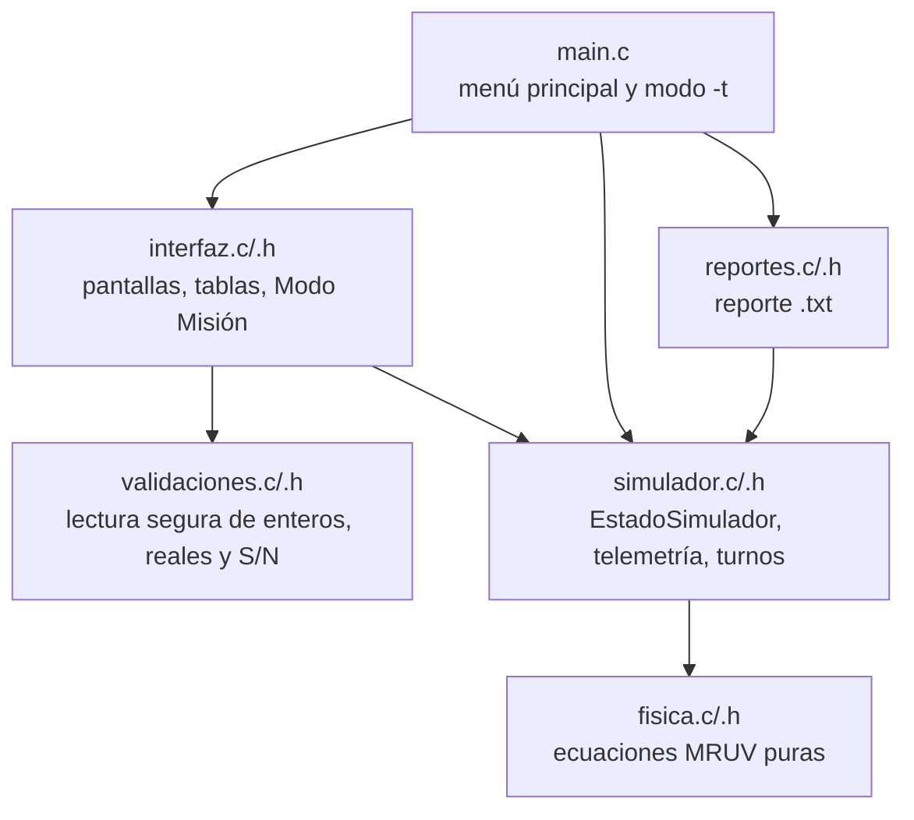

# Proyecto ARTEMIS — Simulador de Ascenso SLS / Orion (Lenguaje C11)

**Universidad Tecnológica Nacional — Facultad Regional Resistencia**
**Cátedra:** Algoritmos y Estructuras de Datos — Ingeniería en Sistemas de Información
**Trabajo Final Integrador — Situación-Problema 1:** Ascenso y Propulsión con el SLS (MRUV y Desprendimiento)

---

## a) Integrantes y comisión

| Integrante | Legajo 
|---|---|
| Rocco Macías | 30644 |
| _Nombre Apellido_ | _legajo_ |
| _Nombre Apellido_ | _legajo_ 

**Comisión:** 1.1

---

## b) Escenario Artemis y reglas del juego

### Escenario
El cohete **Space Launch System (SLS)** eleva a la nave **Orion** desde el reposo (v₀ = 0 m/s, y₀ = 0 m)
en el Centro Espacial Kennedy. El vuelo vertical se divide en tres fases:

| Fase | Descripción | Modelo |
|---|---|---|
| 1. SRB + núcleo | Acelera a a₁ = 20,0 m/s² durante t₁ = 120,0 s. Luego se desacoplan los SRB. | MRUV |
| 2. Núcleo | Acelera a a₂ = 12,5 m/s² hasta la altitud de corte h = 160.000 m. | MRUV |
| 3. Balística | Motores apagados: la nave sigue subiendo por inercia, frenada por g = 9,80 m/s², hasta el apogeo. | MRUV (caída libre) |

Se desprecia la resistencia del aire. El simulador responde las cuatro preguntas de la consigna
para **cualquier** juego de valores ingresado por el usuario:

| Pregunta | Ecuación | Valor nominal |
|---|---|---|
| a) v₁ y y₁ al desacople | v₁ = v₀ + a₁·t₁ ; y₁ = y₀ + v₀·t₁ + ½·a₁·t₁² | 2.400,00 m/s ; 144.000,00 m |
| b) v₂ al corte de motores | v₂ = √(v₁² + 2·a₂·(h − y₁)) | 2.481,93 m/s (8.934,96 km/h) |
| c) Apogeo si los motores fallan a 160 km | h_máx = h + v₂² / (2·g) | 474.285,71 m (474,29 km) |
| d) Aceleración máxima en múltiplos de g | a₁ / g | 2,04 g |

Caso especial contemplado: si la altitud de corte es **menor** que la alcanzada al desacople, los motores
se apagan durante la Fase 1 (v² = v₀² + 2·a₁·h) y la Fase 2 no ocurre.

### Reglas del Modo Misión (juego por turnos)
1. El programa sortea un **apogeo objetivo** (300, 400, 550 o 700 km).
2. El jugador actúa como **Director de Vuelo** y, en cada turno, elige a₁, t₁, a₂ y la altitud de corte.
3. Gana si el apogeo queda dentro de **±5 %** del objetivo **sin superar 3,0 g** de carga sobre la tripulación.
4. Tiene **3 turnos**. Tras cada intento recibe una pista (apogeo por encima / por debajo) o un aviso de aborto por exceso de g.
5. **Puntaje** por turno = 100 − 2 × error % (0 si se supera el límite de g). Al final se muestra la tabla de turnos y el mejor intento.

---

## c) Funcionamiento

### Menú principal
| Opción | Función |
|---|---|
| 1 | Ejecuta la simulación con los parámetros actuales y responde a), b), c) y d). |
| 2 | Configura a₁, t₁, a₂ y altitud de corte (con validación de tipo y rango). |
| 3 | Restaura los valores nominales de la consigna. |
| 4 | **Simulación paso a paso:** muestrea el vuelo cada Δt segundos, guarda la telemetría en un arreglo de structs y la muestra en tabla. Permite simular una **falla de motores** a una altitud elegida. |
| 5 | **Modo Misión** (juego por turnos descripto arriba). |
| 6 | Guarda el reporte técnico en `reporte_mision_artemis.txt` (incluye telemetría completa y turnos jugados). |
| 0 | Salir. |

### Arquitectura modular



| Módulo | Responsabilidad |
|---|---|
| `fisica.h/.c` | Constantes y structs físicos (`ParametrosFisicos`, `ResultadosFisicos`, `FaseVuelo`). Funciones puras de cálculo: fases, apogeo, carga g y estado de la nave en un instante t. |
| `simulador.h/.c` | `EstadoSimulador` con los **arreglos** `telemetria[MAX_TELEMETRIA]` e `intentos[MAX_INTENTOS]`. Generación y análisis de telemetría, lógica del juego y autoprueba. |
| `validaciones.h/.c` | Lectura por línea con `fgets` + `strtol`/`strtod`: rechaza letras, valores mixtos (`12abc`), `nan`/`inf`, vacíos, líneas largas y fuera de rango; acepta coma decimal; maneja EOF sin bucle infinito. |
| `interfaz.h/.c` | Menú, presentación de resultados, tabla de telemetría y flujo del Modo Misión. |
| `reportes.h/.c` | Escritura del reporte en disco, verificando que el archivo se haya podido abrir. |
| `main.c` | Solo `main()`: inicialización, menú y modo de prueba `-t`. |

**Estructuras y punteros:** no hay variables globales. Todos los módulos reciben `EstadoSimulador *` o
`const ParametrosFisicos *` (paso por referencia); las funciones de cálculo devuelven varios valores
mediante parámetros puntero (`estado_en_tiempo(..., double *h, double *v, double *a)`).

---

## d) Compilación y ejecución

Requisito: **GCC** (Linux, macOS o Windows con MSYS2 UCRT64).

```bash
make            # compila en bin/artemis (bin/artemis.exe en Windows)
make test       # compila y ejecuta la autoprueba
./bin/artemis   # ejecuta el simulador
```

Compilación manual equivalente:

```bash
gcc -std=c11 -Wall -Wextra -Wpedantic -Werror -Iinclude src/*.c -lm -o bin/artemis
```

En **VS Code (Windows)**: `Ctrl + Shift + B` usa la tarea de `.vscode/tasks.json` (MSYS2 UCRT64) y
genera `bin\artemis.exe`. Desde la terminal: `bin\artemis.exe`.

### Prueba automática
`./bin/artemis -t` verifica 12 resultados contra los valores calculados a mano (escenario nominal, telemetría,
corte de motores en Fase 1 y falla de motores a 150 km), genera el reporte y devuelve **exit code 0** si todo es correcto.

### Casos de prueba de validación

| ID | Entrada | Resultado esperado |
|---|---|---|
| TC-01 | `abc`, `*#@`, `1abc` en el menú | Error de tipo, vuelve a pedir el dato |
| TC-02 | `99`, `-5` en el menú | Error de rango [0 - 6] |
| TC-03 | Enter vacío o solo espacios | "No ingresó ningún valor" |
| TC-04 | Línea de más de 127 caracteres | "Entrada demasiado larga", sin desbordar el búfer |
| TC-05 | `nan`, `inf`, `1e300`, `-50` en parámetros | Rechazados (tipo o rango) |
| TC-06 | `12,5` | Aceptado como 12.5 |
| TC-07 | `x`, `si` en preguntas S/N | Error, pide una sola letra S o N |
| TC-08 | Ctrl+Z (Windows) / Ctrl+D (Linux) | Cierre controlado, sin bucle infinito |
| TC-09 | a₁ = 100, t₁ = 10, h = 1.000 m | Corte en Fase 1: v = 447,21 m/s, apogeo 11.204,08 m |
| TC-10 | Reporte sin permiso de escritura | Mensaje de error (no informa éxito falso) |

---

## e) Registro de uso de Inteligencia Artificial

> Cada integrante debe completar sus propias entradas. Las filas de abajo son las ya registradas;
> agreguen las suyas con el mismo formato.

| Herramienta | Integrante | Tarea | Consulta / prompt (resumen) | Cómo se validó / adaptó |
|---|---|---|---|---|
| Claude (Anthropic) | Rocco Macías | Revisión de la v2 contra la consigna y la rúbrica | "Este es mi trabajo con la consigna, ¿qué le falta?" | Se confirmaron las fallas ejecutando el programa (bucle infinito con EOF, `nan` aceptado, apogeo erróneo si h_corte < y₁, falta de arreglos). |
| Claude (Anthropic) | Rocco Macías | Refactorización v3: validaciones con `fgets`/`strtod`, telemetría en arreglo, falla de motores, Modo Misión, autoprueba `-t`, README | "Hacé la v3 con las correcciones propuestas" | Compilación con `-Wall -Wextra -Wpedantic -Werror -Wconversion` y sanitizers; autoprueba `-t` (12/12 OK); resultados verificados a mano con las ecuaciones de MRUV; pruebas TC-01 a TC-10. |
| _completar_ | | | | |
